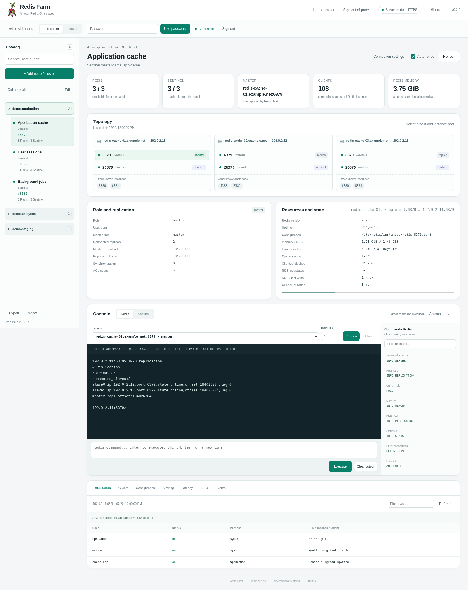
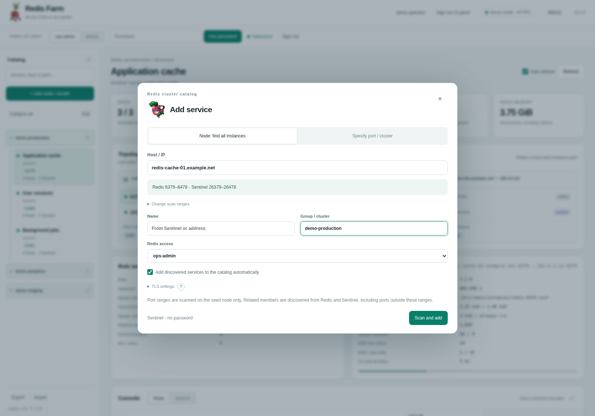
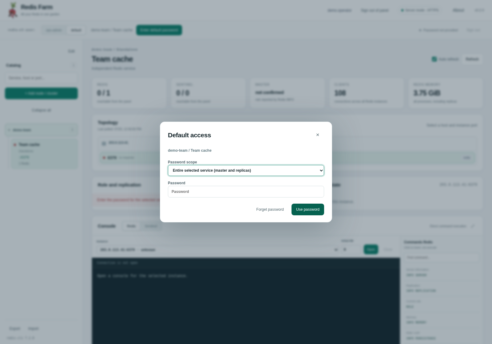
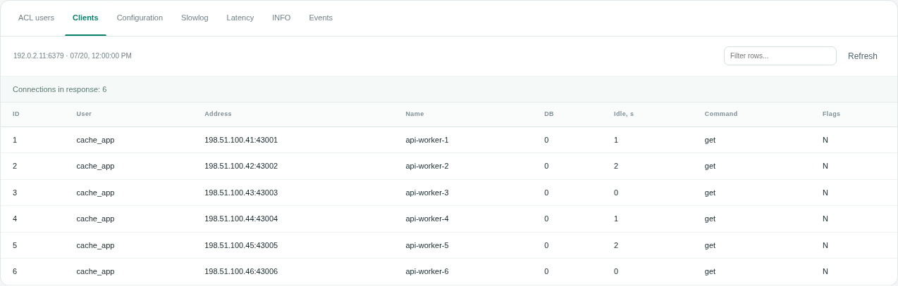
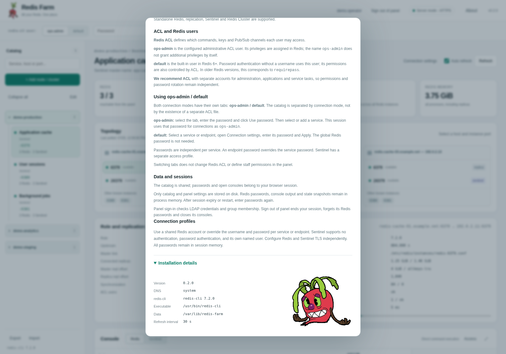
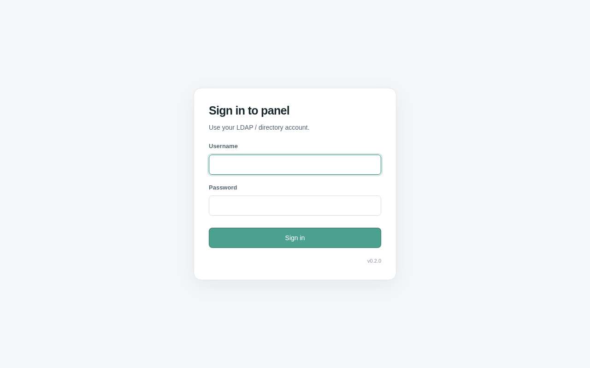

# Redis Farm 0.2.0

<!-- redis-farm:badges:start -->
[](https://github.com/swapovski/redis-farm/actions/workflows/ci.yml)
[](#requirements)
[](LICENSE)
[](https://github.com/swapovski/redis-farm/stargazers)
<!-- redis-farm:badges:end -->

**All your Redis in one garden.** A Flask web workspace for administrators of Redis, Redis Sentinel and Redis Cluster. Every Redis operation is executed by a local `redis-cli` process: no SSH agent, redis-py or separate network Redis client.

[Russian / Русский](README.ru.md) · [Troubleshooting](docs/TROUBLESHOOTING.md) · [Architecture](docs/ARCHITECTURE.md) · [Test report](docs/TEST_REPORT.md)

## Screenshots

Example of the application JavaScript template.



<details><summary>Add a node or service</summary>



</details>
<details><summary>Separate default-user access</summary>



</details>
<details><summary>Client diagnostics</summary>



</details>
<details><summary>About and installation details</summary>



</details>

<details><summary>LDAP sign-in</summary>



</details>

## What it does

Add a seed host and scan selected Redis/Sentinel ports, or specify a port/list/range. Redis defaults to 6379-6478 and Sentinel to 26379-26478; both ranges can be changed. Gaps do not stop discovery. Ranges are scanned only on the supplied seed; the remaining hosts and ports come from replication, Sentinel or Cluster topology. Independently deployed services cannot be discovered merely because they share a network.

The shared catalog has groups, search, **Expand all / Collapse all**, import/export and an **Edit** button above the catalog. It opens with groups collapsed; refresh does not undo your changes. Topology displays explicit hostnames and IPs on one line; it does not guess names with PTR. Manually adding the same address with its hostname preserves the matching service/instance identifiers rather than deliberately creating a duplicate.

Per-instance views include roles, replication, memory, persistence, clients, ACL, configuration, slow log and latency. Redis and Sentinel have separate persistent CLI consoles, with command hints that insert rather than immediately execute commands. Administrators are responsible for their commands; no ACL rewriting or trial application is performed.

## Deployment choices

| Mode | Where redis-cli runs | Panel access |
|---|---|---|
| Local | Employee's computer | HTTP on `127.0.0.1`; no LDAP |
| Ubuntu server | Panel server | HTTPS on a chosen interface IP; LDAP or explicitly selected no-login mode |

Server installer: Ubuntu 22.04/24.04, Python 3.10+ and systemd. Local code targets Linux, macOS and Windows through WSL. Native Windows is not supported. macOS/WSL and a live systemd deployment were not exercised in the build environment; see the test report.

### Requirements

Use **redis-cli 7+** with `--json`, `--user`, `--no-raw`, `-2` and `-e`. This is a client requirement, not a requirement to upgrade your remote Redis. A local Redis server is not needed.

On Ubuntu:

```bash
sudo apt update
sudo apt install -y python3 python3-venv redis-tools openssl ca-certificates curl
redis-cli --version
```

Some distributions supply an older `redis-tools`. The server installer can inspect another explicit path or, after you choose `install`, download the official standalone client into `/opt/redis-farm/bin`. It never silently replaces `/usr/bin/redis-cli`. A controlled environment should supply its approved client binary instead.

The optional upstream installer is `https://packages.redis.io/redis-cli/install.sh`, not a Redis Farm release download address. Its installation requires Internet access. Application Python packages require a reachable package index or an approved local mirror.

## Local installation

Clone this repository or unpack the release, then enter its root:

```bash
cd redis-farm
bash install.sh
bash start.sh
```

The first run asks for **language** (`en` by default or `ru`), optional internal DNS, the CLI path, whether a named ACL user is used and that user's name. No Redis password is requested or saved by the installer. Settings go to `local.json`, packages to `.venv`, catalog to `data/`.

Open `http://127.0.0.1:8765/`. Stop with Ctrl+C. LDAP configuration is neither loaded nor required, even if a server connector exists elsewhere on the computer.

Non-interactive example:

```bash
bash install.sh --non-interactive --language en --system-dns \
  --redis-cli /usr/bin/redis-cli --use-acl-user yes --admin-user admin
bash start.sh --no-browser
```

Runtime overrides include `--language ru`, `--admin-user operations`, `--dns-server IP`, `--system-dns`, `--port` and `--data-dir`. They do not overwrite saved settings.

## First Ubuntu server installation

```bash
sudo bash install-server.sh
```

Choose language first. Then enter the server's **real assigned interface IP**, HTTPS port (8765 by default), internal DNS or OS DNS, allowed administrative client networks, the CLI path and named Redis user. Finally choose `ldap` or `none` for panel login.

**No company domain, DNS IP, LDAP DN or subnet is preselected.** The addresses in example files (`192.0.2.x`, `198.51.100.x`, `203.0.113.x`) and `example.net` are documentation placeholders; replace them. The application initially uses an IP URL. A domain/reverse proxy can be added later.

Selecting `none` requires typing `NO_AUTH` (or explicitly supplying `--allow-no-auth`). Without login, every allowed client can access the shared catalog and unauthenticated Sentinel. Keep the panel behind suitable network controls or an authenticated proxy. A Redis password is not a substitute for panel access control. No-login mode does not load LDAP settings or install ldap3.

Example **after replacing the example IP and network**:

```bash
sudo bash install-server.sh --non-interactive --language en \
  --host 192.0.2.10 --port 8765 --system-dns \
  --allow-cidr 192.0.2.0/24 --redis-cli /usr/bin/redis-cli \
  --admin-user operations --use-acl-user yes \
  --panel-auth none --allow-no-auth
```

The installer creates a dedicated `redis-farm` account, an isolated versioned virtual environment and `redis-farm.service`. A self-signed HTTPS certificate is generated locally if none exists. Verify its fingerprint before trusting it, or provide a certificate issued by your organization. Firewalls and unrelated services are not changed.

### Why the installer asks for internal DNS

A Redis instance can listen only on its internal interface (`bind` to an internal IP). Its public IP does not then accept the same Redis connection. With split DNS, the normal resolver may return a public address while the corporate resolver returns the usable private address.

Specify the internal DNS **IP** to resolve Redis/Sentinel names from that view. Leave it empty to use OS DNS. The panel machine still needs a route/VPN and firewall permission: **DNS does not provide network access**. In server mode it is the server, not the browser's computer, that must reach Redis and DNS.

Internal DNS is tried first. Missing records, DNS errors or timeouts trigger OS resolution. A successful answer is not replaced because a Redis connection or command fails; changing commands are never retried on another address. Literal IPs bypass DNS. Public-only Redis addresses are supported. Manual `CONNECT` or `-c` hostname redirects inside redis-cli use its own OS resolver rather than the panel's custom resolver.

### Persistent server paths

```text
/opt/redis-farm/current                         active release symlink
/opt/redis-farm/releases/                       application versions and .venv
/etc/redis-farm/server.json                     network, language, Redis user, panel mode
/opt/redis-farm/connectors/connector_settings.py LDAP settings (only in LDAP mode)
/etc/redis-farm/tls/                            panel HTTPS certificate/key
/var/lib/redis-farm/inventory.sqlite3            shared catalog
/etc/systemd/system/redis-farm.service          service unit
```

Only one Gunicorn worker must own the in-memory sessions. Do not increase workers without redesigning that storage. Request concurrency is provided by threads and a bounded CLI process pool.

## LDAP mode

The installer reads an existing complete connector without prompting or rewriting it. Missing required fields are requested. The connector is parsed as literal data, not executed as arbitrary Python. A new connector proposes generic DN examples, not an organization-specific directory.

```python
LDAP_CONFIG = {
    'URL': 'ldap://ldap.example.net:389',
    'BASE_DN': 'ou=people,dc=example,dc=net',
    'USER_LOGIN_ATTR': 'uid',
    'GROUP_BASE_DN': 'ou=groups,dc=example,dc=net',
    'REQUIRE_GROUP': 'cn=redis_farm_users,ou=groups,dc=example,dc=net',
    'TLS_MODE': 'starttls',
    'VERIFY_CERTIFICATE': True,
    'CA_CERT_FILE': None,
    'CONNECT_TIMEOUT': 5,
    'RECEIVE_TIMEOUT': 10,
}
```

Use a trusted CA file when your private CA is not in system trust. `ldaps` is also supported. Explicit `plain` is possible with `ALLOW_PLAINTEXT=True` and no certificate requirement; it sends the employee password without TLS on the panel-to-LDAP link. Existing explicit plain configurations are not silently converted to TLS.

Authentication binds directly as `<attribute>=<login>,<BASE_DN>`, then checks membership in the exact required group. Nested membership is traversed within the group search base with limits and cycle protection. For example, add `operations_users` **as a member of** `redis_farm_users`, not the other way around. Users can remain only in the nested group. The authenticated user needs read access for these searches. BIND_DN/BIND_PASSWORD are not used.

This is DN-based LDAP with group `member` checks; it is not an OIDC/SAML provider or automatic Active Directory UPN discovery. Existing sessions are not continuously revalidated against directory group changes. Sign out/session expiry ends access; restart the panel for immediate invalidation of all its sessions.

## Redis access and everyday use

The **named-user tab** is `admin` by default, or the configured username such as `operations`. The UI label and `redis-cli --user` change together. The internal catalog profile remains stable so upgrades do not rewrite identities. One named username is configured per installation.

The **default** tab sends a password without `--user`. It has separate service passwords and optional per-endpoint overrides; the latter take precedence. Switching tabs does not open a password dialog. Select a locked service/instance or use its access button. The admin password is not required for default.

Choose Add node/cluster, enter a hostname/IP and optional group. Discover from a node or specify exact ports. After successful saving, use **Go to catalog**. Select the service, then a particular Redis or Sentinel port. An open console remains bound to its starting connection until explicitly reopened; selecting another card does not silently move it.

All Redis access uses the CLI. Passwords reside only in process memory per web session, passed via the environment of the appropriate child process, not through URLs or `-a`. The app does not persist them in SQLite, cookies, browser storage, connectors or exports. LDAP passwords are used only for login and never as Redis passwords. Redis CLI history files are disabled. Operating-system swap, core dumps and external monitoring remain deployment considerations.

The catalog is shared, while credentials and terminal buffers are session-specific. Export/import includes non-secret catalog settings. Sentinel is currently supported **without Sentinel authentication**. Per-service TLS supports `--tls`, CA and SNI, not client-certificate mTLS. Persistent consoles are line-oriented stdin/stdout, not a full PTY or SSH shell.

## Updating an existing installation

Unpack 0.2.0 into a separate source folder. Finish current console work, then run:

```bash
sudo bash install-server.sh --skip-apt
```

Existing server.json, connectors, DNS, domain/proxy settings, Redis CLI path, catalog, certificate and local artwork are preserved. Older installations without a language setting remain Russian; LDAP is not silently disabled. Explicit `--language en` or `--admin-user NAME` changes just the selected preference and makes a settings backup. Avoid switching named users while anyone is using the panel: update restarts its sessions.

The installer creates a new release, validates imports/configuration and tests HTTP access gates with fake identities before activation. LDAP transport is checked only in LDAP mode, without an employee bind. Activation failures restore the previous release link/configuration where applicable. **A successful update restarts the panel and clears its sessions/consoles**, never the remote Redis/Sentinel servers.

Artwork is bundled for clean installs. During upgrades, local images can be recovered from the previous release, older releases or `/opt/redis-farm.bak`. Known old names are recognized and favicon can be built locally from the logo. No CDN request is needed. Old hotfixes are already integrated; do not apply them over 0.2.0.

`--skip-apt` skips OS packages, not the new release's Python dependencies. For reproducible production builds, resolve the provided requirement ranges into your organization's approved lock/constraints file and package index.

## Domain and reverse proxy, later

After DNS and your certificate are ready, adapt [nginx.example.conf](deploy/ubuntu/nginx.example.conf). Keep browser `Host` intact (`proxy_set_header Host $host`), set one trusted `X-Real-IP`, and disable response buffering for console updates. Never spoof or remove Origin.

The supplied configuration helper supports an explicit external origin and the proxy's exact source IP:

```bash
sudo python3 deploy/ubuntu/configure_proxy.py \
  --origin https://redis-farm.example.net --proxy-ip 192.0.2.10
```

Both values are examples. The application still listens on 8765, while Nginx may serve 443. Trust is limited to configured proxies. The Nginx sample leaves upstream certificate verification off for the initial self-signed backend; configure upstream CA/name verification for your deployment. Changes require `nginx -t`, panel restart and Nginx reload. Do not overwrite an existing working proxy configuration merely to upgrade.

## Checks and repository contents

```bash
python3 -m pip install -r requirements-dev.txt
python3 tools/test_all.py
# Install Chromium separately; set CHROMIUM if it is not /usr/bin/chromium.
python3 tools/render_demo.py
```

The first runs each unittest module in isolation and reports skipped dependencies honestly. Install development/browser packages first for the second command; it renders synthetic data and does not log into Redis/LDAP. See [test report](docs/TEST_REPORT.md) for the exact checks executed in this build and limitations. There is no claim of production validation solely from mock tests.

Keep `docs/images/` in the repository: README image paths are relative and work in GitLab and GitHub. Do not commit local.json, connectors, server.json, private keys, production exports or runtime directories. [.gitignore](.gitignore) excludes these paths.

[Code license](LICENSE) · [Artwork notice](NOTICE.md). Bundled game artwork is not covered by the code license; review the separate notice before public redistribution.
