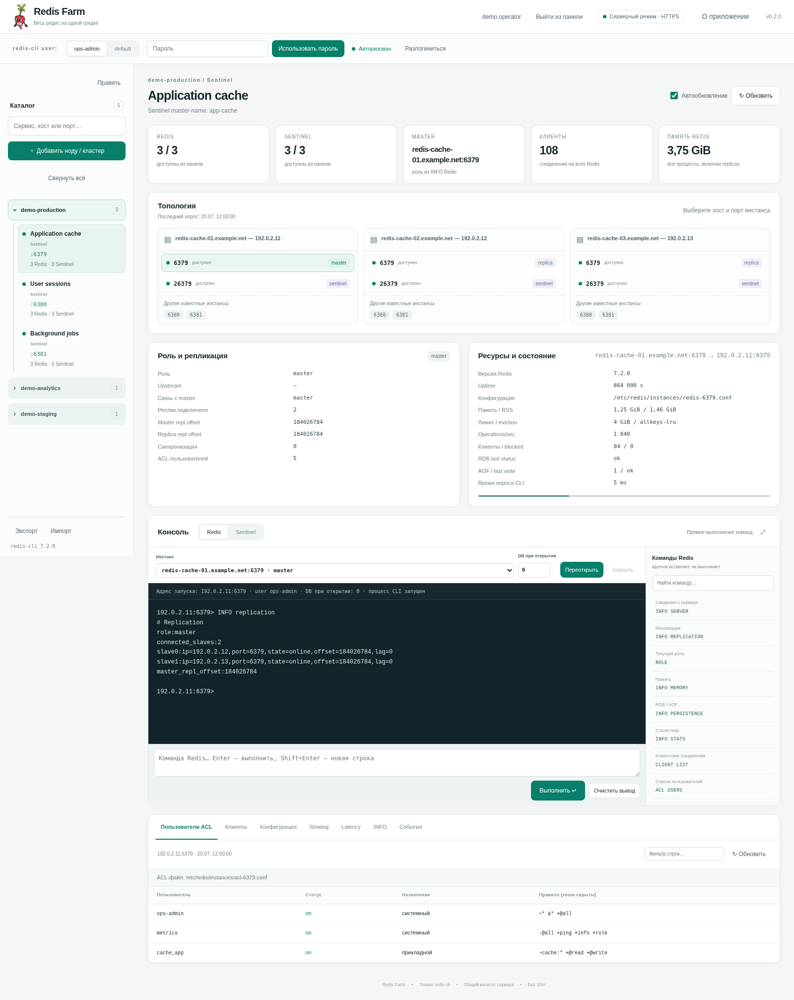
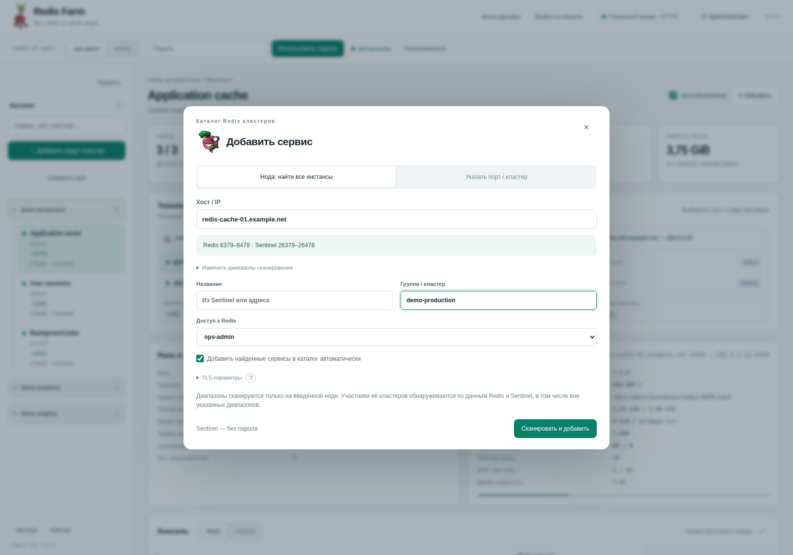
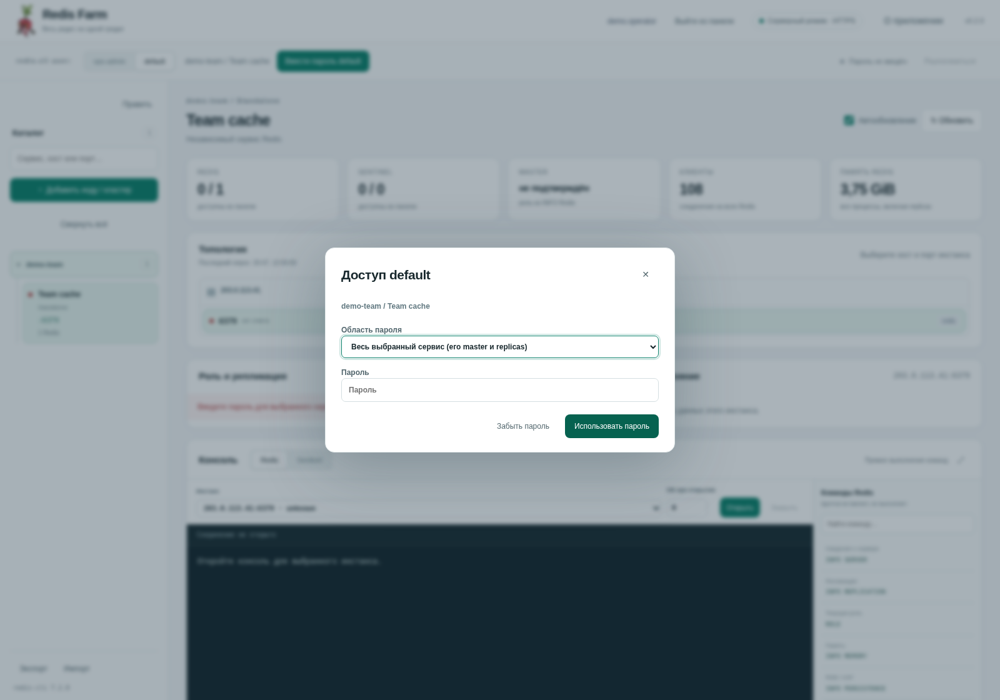
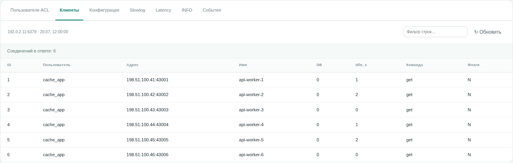
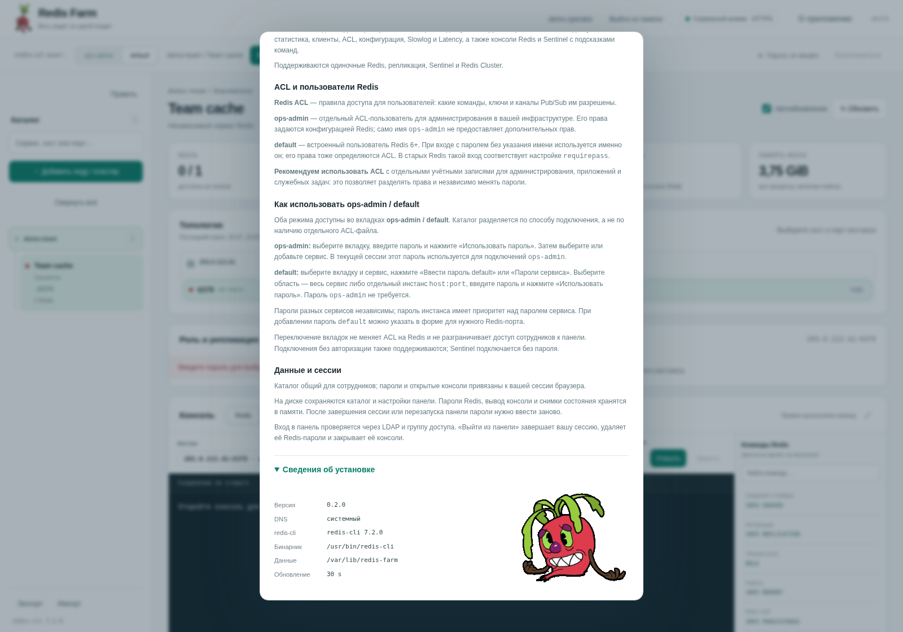

# Redis Farm 0.2.0

**Весь редис на одной грядке.** Веб-панель на Flask для администраторов Redis, Sentinel и Redis Cluster. Все обращения к Redis выполняются через локальные процессы `redis-cli`: без SSH, агентов на нодах и redis-py.

[English](README.md) · [Диагностика](docs/TROUBLESHOOTING.md) · [Архитектура](docs/ARCHITECTURE.md) · [Отчёт о проверках](docs/TEST_REPORT.md)

## Скриншоты

Ниже — настоящий интерфейс с приложенными изображениями. **Все кластеры, адреса, пользователи, метрики и вывод консоли вымышлены.** При установке демонстрационные записи не добавляются. В примере административный пользователь назван `ops-admin`; установщик по умолчанию предлагает `admin`.



<details><summary>Добавление ноды или сервиса</summary>



</details>
<details><summary>Пароль default для сервиса или инстанса</summary>



</details>
<details><summary>Подключённые клиенты</summary>



</details>
<details><summary>О приложении и сведения об установке</summary>



</details>

## Возможности

Добавление по имени ноды или IP с опросом выбранных диапазонов Redis и Sentinel; также поддерживается конкретный порт, список и диапазон портов. По умолчанию используются `6379–6478` и `26379–26478`, но границы настраиваются. Пропуски портов не останавливают поиск. На начальной ноде сканируются диапазоны, на остальных — конкретные endpoint из репликации, Sentinel или Redis Cluster. Отдельные, не связанные топологией сервисы на других хостах автоматически не инвентаризируются.

Каталог объединяется в сворачиваемые группы. Есть поиск, **«Развернуть всё / Свернуть всё»**, импорт, экспорт и **«Править»** над каталогом. При открытии страницы группы свёрнуты; автообновление не сбрасывает последующие действия пользователя.

В топологии явно заданное имя и IP выводятся одной строкой. PTR не используется. Повторное добавление FQDN, соответствующего существующему адресу и порту с теми же параметрами доступа, обновляет представление ноды без намеренного создания дубликата и без замены её ID.

Доступны роли и репликация, память, RDB/AOF, клиенты, ACL, конфигурация, Slowlog, Latency, постоянные консоли Redis/Sentinel и подсказки команд. Подсказка вставляет команду, а не выполняет её. Панель предназначена для обученных администраторов: пробное применение, автоматическое исправление ACL и скрытые повторы изменяющих команд не выполняются.

## Режимы запуска

| Режим | Где работает redis-cli | Вход в панель |
|---|---|---|
| Локальный | Компьютер сотрудника | HTTP на `127.0.0.1`, без LDAP |
| Сервер Ubuntu | Сервер панели | HTTPS на выбранном IP; LDAP или явно выбранный режим без входа |

Серверный установщик предназначен для Ubuntu 22.04/24.04, Python 3.10+ и systemd. Локальная кодовая база предназначена для Linux, macOS и Windows через WSL. Нативная Windows не поддерживается. Запуск на macOS/WSL и полноценная установка systemd в среде подготовки не проверялись — см. отчёт.

### Подготовка redis-cli

Нужен **redis-cli 7+** с параметрами `--json`, `--user`, `--no-raw`, `-2`, `-e`. Это требование к клиенту панели, не требование обновить удалённые Redis. Устанавливать локальный Redis Server не нужно.

На Ubuntu:

```bash
sudo apt update
sudo apt install -y python3 python3-venv redis-tools openssl ca-certificates curl
redis-cli --version
```

В некоторых выпусках ОС пакет `redis-tools` содержит старую версию. При несовместимом клиенте серверный установщик позволяет указать другой абсолютный путь либо явно выбрать `install`: официальный отдельный клиент будет установлен в `/opt/redis-farm/bin`, без замены `/usr/bin/redis-cli`.

Адрес официального установщика клиента — `https://packages.redis.io/redis-cli/install.sh`. Это **не ссылка на обновления Redis Farm**. Для такого скачивания нужен Интернет. В управляемой инфраструктуре используйте утверждённый бинарник. Python-пакетам также нужен доступный индекс или внутреннее зеркало.

## Локальная установка

Клонируйте репозиторий или распакуйте архив и перейдите в корень проекта:

```bash
cd redis-farm
bash install.sh
bash start.sh
```

При первой установке выберите **`ru`** в вопросе `Language / Язык (en/ru)`. По умолчанию для новой установки выбран английский. Далее задайте внутренний DNS либо системное разрешение, путь к клиенту, использование отдельного ACL-пользователя и его имя. Установщик не запрашивает пароль Redis.

Настройки записываются в `local.json`, зависимости — в `.venv`, каталог — в `data/`. Откройте `http://127.0.0.1:8765/`. Остановка — Ctrl+C. **LDAP-коннектор не читается, LDAP-запросов нет.**

Пример без вопросов:

```bash
bash install.sh --non-interactive --language ru --system-dns \
  --redis-cli /usr/bin/redis-cli --use-acl-user yes --admin-user admin
bash start.sh --no-browser
```

Параметры запуска `--language`, `--admin-user`, `--dns-server`, `--system-dns`, `--port` и `--data-dir` переопределяют выбранные значения, не переписывая сохранённый файл.

## Первая установка на Ubuntu-сервер

```bash
sudo bash install-server.sh
```

Мастер сначала спрашивает язык. Затем — **реальный IP интерфейса этого сервера**, порт HTTPS (по умолчанию 8765), DNS, разрешённые административные подсети клиентов, путь к redis-cli и административного Redis-пользователя. В конце выберите способ входа в панель: `ldap` или `none`.

В программе нет предустановленного домена организации, внутреннего DNS или DN вашей инфраструктуры. Адреса `192.0.2.x`, `198.51.100.x`, `203.0.113.x` и `example.net` в примерах — **условные значения для документации**, их необходимо заменить. Первоначально панель открывается по введённому IP; домен и reverse proxy настраиваются отдельно.

Выбор `none` требует подтверждения `NO_AUTH` или явного параметра `--allow-no-auth`. Без входа любой допущенный клиент может пользоваться общим каталогом и Sentinel без пароля. Нужны подходящие сетевые ограничения или внешний прокси с аутентификацией. Пароль Redis сам по себе не закрывает веб-панель. В режиме `none` LDAP-настройки не читаются, пакет ldap3 для установки не требуется.

Пример **после замены IP и подсети на ваши**:

```bash
sudo bash install-server.sh --non-interactive --language ru \
  --host 192.0.2.10 --port 8765 --system-dns \
  --allow-cidr 192.0.2.0/24 --redis-cli /usr/bin/redis-cli \
  --admin-user operations --use-acl-user yes \
  --panel-auth none --allow-no-auth
```

Создаются отдельный пользователь `redis-farm`, виртуальное окружение релиза и `redis-farm.service`. Если сертификата панели ещё нет, он генерируется на сервере. Перед доверием самоподписанному сертификату сверьте отпечаток либо установите сертификат организации. Установщик не меняет firewall и не перезапускает посторонние службы.

### Зачем вводить внутренний DNS

Если Redis слушает только внутренний интерфейс (`bind` на внутренний IP), подключение через redis-cli возможно по этому адресу, а не по внешнему IP хоста. При split DNS одно имя может возвращать внешний адрес через обычный DNS и внутренний — через корпоративный.

Укажите **IP внутреннего DNS**, чтобы панель получала внутренние адреса Redis/Sentinel. Пустой ответ означает системный DNS. При этом с машины запуска панели нужны маршрут/VPN и разрешение firewall: **DNS не создаёт сетевой доступ**. В серверном режиме к Redis обращается сервер панели, а не компьютер с браузером.

При отсутствии записи или ошибке внутреннего DNS используется системный резолвер. Если внутренний DNS ответил успешно, ошибка TCP или Redis не приводит к подмене адреса и повтору команды. Redis с только внешними IP поддерживаются; явно введённые IP не требуют DNS. Ручной `CONNECT` и переходы `-c` по hostname внутри CLI используют собственный системный резолвер redis-cli.

### Постоянные серверные пути

```text
/opt/redis-farm/current                         активный релиз
/opt/redis-farm/releases/                       версии приложения и .venv
/etc/redis-farm/server.json                     адрес, DNS, язык, Redis user, вход
/opt/redis-farm/connectors/connector_settings.py LDAP-коннектор, только для LDAP
/etc/redis-farm/tls/                            HTTPS-сертификат и ключ
/var/lib/redis-farm/inventory.sqlite3            общий каталог
/etc/systemd/system/redis-farm.service          systemd unit
```

В памяти **одного** Gunicorn worker хранятся сессии. Параллелизм обеспечивают потоки и ограниченный пул CLI-процессов. Увеличивать workers без переработки хранения сессий нельзя.

## Настройка LDAP

Готовый и заполненный коннектор используется без вопросов и переписывания. Если отсутствуют обязательные значения, установщик запросит их. Файл разбирается как словарь данных — произвольный Python из коннектора не выполняется. Все начальные DN в новой установке являются примерами.

```python
LDAP_CONFIG = {
    'URL': 'ldap://ldap.example.net:389',
    'BASE_DN': 'ou=people,dc=example,dc=net',
    'USER_LOGIN_ATTR': 'uid',
    'GROUP_BASE_DN': 'ou=groups,dc=example,dc=net',
    'REQUIRE_GROUP': 'cn=redis_farm_users,ou=groups,dc=example,dc=net',
    'TLS_MODE': 'starttls',
    'VERIFY_CERTIFICATE': True,
    'CA_CERT_FILE': None,
    'CONNECT_TIMEOUT': 5,
    'RECEIVE_TIMEOUT': 10,
}
```

Для частного CA, отсутствующего в системном хранилище доверия, задайте путь к доверенному сертификату. Поддерживается также `ldaps`. Режим `plain` разрешён только при явном `ALLOW_PLAINTEXT=True`: CA для него не нужен, но пароль сотрудника передаётся без TLS на участке панель → LDAP. Существующий явно настроенный `plain` при обновлении не переключается на TLS.

Вход выполняется напрямую с DN вида `<атрибут>=<логин>,<BASE_DN>`, затем проверяется точная группа допуска. Вложенность обходится в пределах базы групп с ограничениями глубины/объёма и защитой от циклов. Например, существующая `operations_users` должна быть **участником `redis_farm_users`**, не наоборот. Пользователи могут оставаться только во вложенной группе. Сотруднику нужен доступ для соответствующего чтения LDAP. `BIND_DN` и `BIND_PASSWORD` не используются.

Это DN-based LDAP с проверкой `member`, а не OIDC/SAML и не автоматический поиск UPN Active Directory. Членство не перепроверяется непрерывно для уже открытой сессии. Выход/истечение сессии прекращают доступ; для немедленного завершения всех сессий перезапустите только панель.

## Работа с admin / default

Вкладка именованного пользователя называется **admin**, если при установке не задано другое имя. Например, `operations` одновременно меняет подпись вкладки и аргумент `redis-cli --user`. Внутренний профиль каталога остаётся прежним, поэтому ID старых записей не переписываются. На одну установку задаётся одно имя административного пользователя.

Во вкладке **default** пароль передаётся без `--user`. Для каждого сервиса можно задать свой пароль и переопределения для конкретных инстансов. Пароль инстанса приоритетнее общего. Переключение на default не открывает диалог: выберите закрытый сервис/инстанс либо нажмите кнопку доступа. Пароль admin для этого не нужен.

Нажмите «Добавить ноду / кластер», задайте адрес и группу. Можно сканировать ноду или указать точные порты. После сохранения нажмите **«Перейти в каталог»**. Выберите сервис, затем конкретный Redis/Sentinel. Открытая консоль не переключается на другой endpoint молча при выборе карточки.

**Пароли Redis хранятся только в памяти процесса и отдельно для каждой веб-сессии.** Они передаются через окружение конкретного CLI-процесса, не через URL или `-a`; не записываются в SQLite, cookie, localStorage, connectors или экспорт. LDAP-пароль используется только для входа. Файловая история CLI отключена. Swap, дампы памяти и внешние системы диагностики требуют отдельного контроля на уровне ОС.

Каталог общий, а пароли и вывод терминала принадлежат сессии. Экспорт переносит только настройки каталога без паролей. Sentinel пока поддерживается **без собственной авторизации**. TLS-подключения Redis поддерживают CA/SNI, но не клиентские сертификаты mTLS. Консоль сохраняет CLI-процесс между командами, однако не является полноценным PTY или SSH shell.

## Обновление

Распакуйте новую версию в отдельный каталог исходников. Завершите работу в открытых консолях и выполните:

```bash
sudo bash install-server.sh --skip-apt
```

Существующие server.json, LDAP-коннектор, DNS, домен/прокси, путь к CLI, каталог, сертификат и картинки сохраняются. Старая установка без поля языка остаётся русской, LDAP не отключается автоматически. Явные `--language en` или `--admin-user NAME` изменяют выбранные настройки с резервной копией.

Установщик готовит отдельный релиз, проверяет импорты и HTTP-защиту на вымышленных пользователях, затем конфигурацию. В режиме LDAP отдельно проверяется транспорт без входа сотрудника. Только после успешных проверок переключается `current` и перезапускается панель; при ошибке активации предусмотрено восстановление прежней ссылки/настроек.

**Обновление завершает сессии и консоли панели**, пароли потребуется ввести заново. Удалённые Redis/Sentinel не перезапускаются.

В чистом дистрибутиве есть все три картинки и favicon. При обновлении локальные изображения имеют приоритет: поиск выполняется в предыдущем релизе, старых релизах и известном бэкапе `/opt/redis-farm.bak`, с поддержкой прежних имён. Скачивания с CDN не требуется. Старые hotfix уже включены — не применяйте их поверх 0.2.0.

`--skip-apt` пропускает только пакеты ОС: зависимостям новой `.venv` нужен индекс Python-пакетов. Для воспроизводимых production-сборок используйте утверждённый организацией lock/constraints-файл и зеркало.

## Домен и Nginx

После настройки DNS и сертификата адаптируйте [пример Nginx](deploy/ubuntu/nginx.example.conf). Сохраняйте имя сайта в `Host $host`, передавайте реальный адрес клиента и отключайте буферизацию ответа. Origin подменять или отключать не нужно.

Пример настройки внешнего адреса и доверенного прокси:

```bash
sudo python3 deploy/ubuntu/configure_proxy.py \
  --origin https://redis-farm.example.net --proxy-ip 192.0.2.10
```

Замените оба условных значения. Порт приложения остаётся 8765, внешний Nginx может использовать 443. Только точным IP из списка прокси доверяется X-Real-IP. В примере Nginx проверка upstream-сертификата отключена для первоначального самоподписанного backend — настройте CA и проверяемое имя для своей среды. Не заменяйте уже работающую конфигурацию Nginx только ради обновления.

## Проверки и файлы репозитория

```bash
python3 tools/test_all.py
python3 tools/render_demo.py
```

Первый скрипт запускает модули unittest отдельно и явно отмечает пропущенные зависимости. Второй требует Jinja2, Playwright и Chromium; создаёт снимки из вымышленных ответов API без соединений с Redis/LDAP. Выполненные проверки и ограничения среды приведены в [отчёте](docs/TEST_REPORT.md), а не выдаются за production-проверку.

Для отображения скриншотов в GitLab/GitHub нужен весь каталог `docs/images/`; ссылки в README относительные. Не публикуйте local.json, connectors, server.json, ключи, рабочие экспорты каталога и runtime-данные. Основные пути исключены через `.gitignore`.

[Лицензия кода](LICENSE) · [Отдельное уведомление об иллюстрациях](NOTICE.md). Игровые изображения не покрываются лицензией кода; перед публичным распространением проверьте права на них отдельно.
